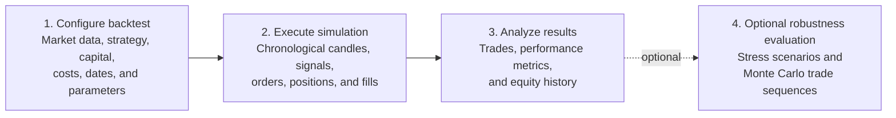

# Nikaido

**A research workbench for testing systematic trading strategies and evaluating
how sensitive their results are to execution assumptions and market conditions.**

## Project overview

Nikaido is a framework for experimenting with and researching trading strategies
using historical market data. It combines backtest execution with analysis tools
so researchers can inspect not only a strategy's baseline results, but also how
those results respond to selected changes in assumptions.

Nikaido is built on Laravel. Refer to the
[Laravel documentation](https://laravel.com/docs) for framework and infrastructure
details.

## Create a Project

Create a Nikaido project with Composer and enter the project directory:

```sh
composer create-project pandu/nikaido nikaido
cd nikaido
```

Continue with the [installation guide](docs/getting-started/installation.md).

## AI-assisted development notice

AI coding assistants may be used to help explore or change this codebase. Their
suggestions are not authoritative: review generated changes and run relevant tests
before relying on them.

## Featured capabilities

- **Robustness-oriented research** — assess how selected price excursions and
  execution assumptions affect completed backtest trades; use optional Monte Carlo
  analysis to explore trade-sequence outcomes.
- **Configurable execution costs** — model bid/ask-aware fills, slippage, partial
  fills, and configurable transaction, holding, and financing costs.
- **Limit entries** — request buy or sell limit entries and evaluate them against
  subsequent historical candles, with pending, partial-fill, fill, and cancellation
  outcomes recorded.
- **Parallel multi-market testing** — run pair backtests as separate queued jobs
  and review pair-level or combined results.
- **Shared-capital simulation** — evaluate multi-pair entries against one capital
  budget, synchronized by the actual event timestamps rather than pair completion
  order.
- **Event-driven backtesting** — process market candles chronologically and
  apply simulated order, fill, exit, and capital changes in sequence.
- **Strategy-centered workflow** — supply strategy decisions and sizing while the
  backtest engine handles historical execution, trade records, and analysis.

## How it works

The primary workflow runs a backtest first. Robustness and Monte Carlo analyses
are optional follow-up analyses over the stored backtest result; they do not rerun
the strategy.



1. **Configure backtest** — select available market data, pair or market type,
   timeframe, date range, initial capital, and execution settings. The strategy
   supplies signal, stop/target, and sizing decisions; the included example
   strategy is a moving-average crossover.
2. **Execute simulation** — process strategy decisions against chronological
   historical candles. At each candle, the engine evaluates applicable orders,
   fills, exits, and new entries, then records the resulting position and
   capital changes. In shared-capital market-type runs, pair simulations run
   independently before their recorded events are replayed in timestamp order.
3. **Analyze results** — inspect completed trades, equity and capital changes,
   performance metrics, and available signal-cluster analysis.
4. **Evaluate robustness (optional)** — run supported stress scenarios or Monte
   Carlo analysis on the stored results to examine sensitivity and trade-sequence
   variation.

Here, “event-driven” describes the simulation's time-ordered processing of
candles and resulting order/fill events. It does not mean that Nikaido uses a
general event bus or event-sourced application architecture. See the
[backtest engine](docs/features/backtest-engine.md) for the single-pair
lifecycle and [shared-capital simulation](docs/features/shared-capital.md)
for multi-pair event ordering.

## Design philosophy

Nikaido is intended to help investigate strategy behavior, not to certify a
strategy as profitable. A positive baseline backtest is only one observation;
research should also examine data quality, execution assumptions, costs, and
sensitivity to adverse conditions.

The current built-in backtest consumes market-price candles. Developers can
extend the data model, ingestion, and strategy input path with their own
economic or company-fundamental datasets for systematic research, but
fundamental data ingestion and point-in-time strategy support are not included
out of the box. See the
[fundamental research extension notes](docs/concepts/backtesting-fundamentals.md#extending-nikaido-for-economic-and-fundamental-research)
before treating such data as available to historical decisions.

## Requirements

- PHP version satisfying Composer's `^8.2` requirement (PHP 8.2 through 8.x)
- Composer
- Node.js and npm for frontend assets
- SQLite by default, or another database supported by the application and Laravel

## Installation and quick start

Create the project and build the frontend assets:

```sh
composer create-project pandu/nikaido
cd nikaido
npm install
npm run build
php artisan nikaido:start
```

Composer installs PHP dependencies and initializes `.env`, the application key,
the default SQLite database file, and database migrations. `npm install` and
`npm run build` install and build the frontend assets. `nikaido:start` starts the
Nikaido development server and queue worker together. By default, the web server
listens at `http://127.0.0.1:8000`.

Stop both processes with:

```sh
php artisan nikaido:stop
```

Open [http://localhost:8000/workbench/tests/create](http://localhost:8000/workbench/tests/create)
to configure a backtest. If using a database other than the default SQLite
configuration, set its connection details in `.env` before running setup.

## Getting Started

- [Installation](docs/getting-started/installation.md) — prepare a local
  development environment.
- [Configuration](docs/getting-started/configuration.md) — understand local
  settings, backtest options, and market-data prerequisites.
- [First backtest](docs/getting-started/first-backtest.md) — run a reproducible
  synthetic smoke test or prepare imported data for research.
- [Running tests](docs/getting-started/running-tests.md) — run and troubleshoot
  the PHPUnit suites.

## Example research workflow

1. Add or import historical market data, then configure the relevant market pair
   and timeframe.
2. Configure the test period, capital mode, strategy decisions and sizing, and
   execution costs.
3. Run a single-pair test or queue a market-type run for multiple eligible pairs.
4. Inspect the trade history, equity results, and pair or portfolio-level output.
5. Optionally run a stress test or Monte Carlo analysis and compare it with the
   baseline. Record the assumptions used when interpreting the comparison.

Market data can be managed from the Workbench. The application includes an
external Alpha Vantage FX import provider and an incoming-candle import workflow;
availability and coverage depend on the selected source and its limits.

## Research limitations

Backtests depend on the quality and coverage of the input data and on the
assumptions encoded by the engine. Candle OHLC data does not reveal the sequence
of all intrabar price movements, so it cannot establish which of multiple touched
levels occurred first. Bid/ask candle fields are used when available; the engine
falls back to generic OHLC fields when a required quote is missing. These
approximations may differ from live execution.

Stress tests and Monte Carlo analysis are scenario and trade-sequence tools, not
forecasts. Monte Carlo bootstrap treats sampled trades as independent and does
not preserve market-regime or temporal dependencies. Nikaido does not guarantee
future performance, model every market condition, or replace independent review
of strategy assumptions and results.

Nikaido is for research and experimentation, not financial or investment advice.
Users are responsible for validating data, assumptions, and results before making
decisions. To the extent permitted by applicable law, the project and its
contributors disclaim responsibility for trading losses or other damages arising
from use of the framework, including losses related to software defects or
incorrect evaluations.

## Documentation

- [Documentation index](docs/README.md)
- [Project overview](docs/PROJECT.md)
- [Coding standards](docs/coding-standar.md)
- [Laravel documentation](https://laravel.com/docs)

## Testing

Run the test suite with:

```sh
php artisan test --compact
```

Format or check PHP code with Laravel Pint:

```sh
vendor/bin/pint
vendor/bin/pint --test
```

## AI-assisted development notice

AI coding assistants may be used to help explore, document, test, or change this codebase.

Before starting any task, AI assistants must read the repository's `AGENTS.md` file and follow its instructions. They must also check for applicable `AGENTS.md` files in relevant subdirectories before modifying files within those areas.

AI assistants should read relevant documentation and inspect the actual implementation before making changes. They must follow the project's coding standards, architecture, and established workflows, avoid unrelated modifications, and never assume that undocumented features or behavior exist.

Review AI-generated changes and run relevant tests or validation commands before relying on them. If a required check cannot be completed, explicitly report that limitation.

Repository instructions do not override higher-priority system or developer instructions.

## Contributing

Contributions that improve research correctness, explainability, and reliability
are welcome. Please include focused tests for behavior changes and describe any
new execution or market-data assumptions in the pull request.

## Project status

Nikaido is an evolving research framework. Features, supported data workflows,
and simulation assumptions may change as the project develops.

## License

The package metadata currently declares the MIT license in `composer.json`.