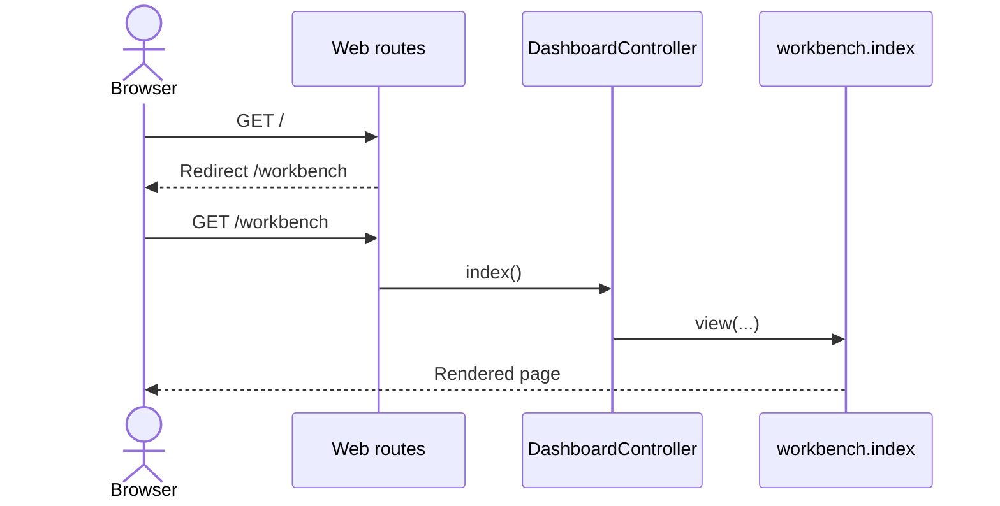
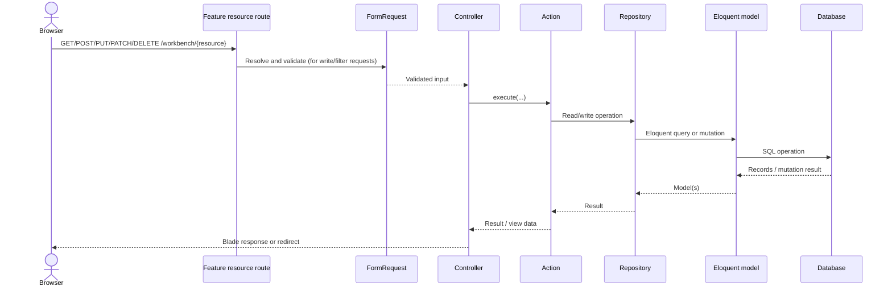
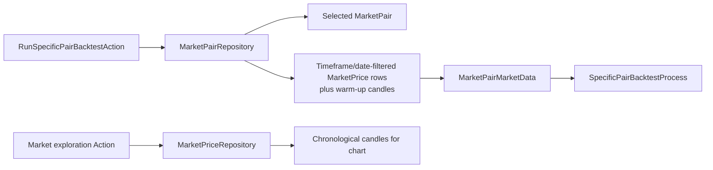
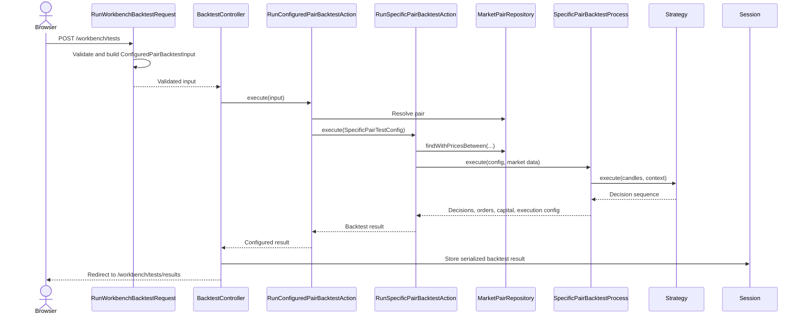
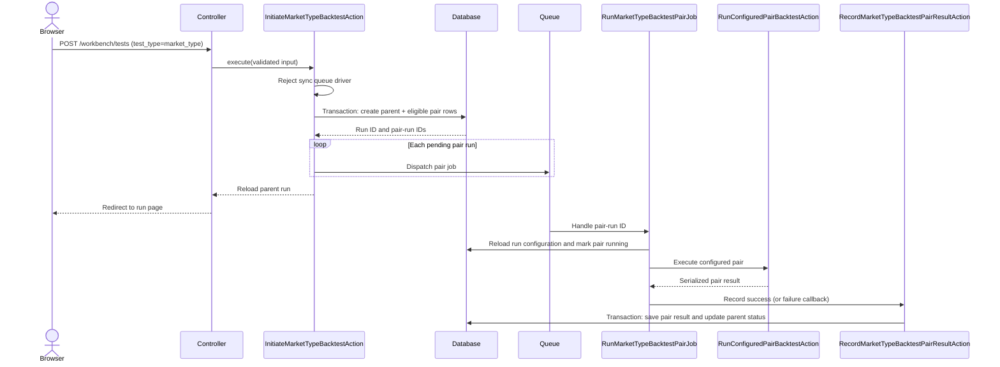

# Application flows

These diagrams trace the implemented Workbench, API, persistence, and queued
execution paths. They complement the user procedures without repeating
feature-specific validation or simulation details; see the
[User Guide](../README.md#user-guide) and [Features](../README.md#features)
for those details. For the registered endpoint inventory, see
[Routes and controllers](../reference/routes-and-controllers.md); for stored
tables and relationships, see [Data models](../reference/data-models.md).

## Dashboard rendering

`GET /` redirects to `/workbench`. The dashboard route dispatches directly to
`DashboardController::index()`, which returns the `workbench.index` Blade
view. This path does not use an Action, repository, or database query.

Implementation: [`routes/web.php`](../../routes/web.php),
[`Dashboard/routes.php`](../../app/Feature/Dashboard/routes.php), and
[`DashboardController`](../../app/Feature/Dashboard/Controller/DashboardController.php).

## Market metadata and price CRUD

Market Pairs, Market Types, Timeframes, and Market Prices use Laravel resource
routes under `/workbench`. Their controllers receive validated FormRequests
where an operation accepts user input, call a feature Action, and return a
view or redirect. The Action invokes its feature Repository for database
operations. List and form-page Actions may gather related records for view
models.

Market-price CRUD is registered by
[`MarketPrice/routes.php`](../../app/Feature/MarketPrice/routes.php) and
implemented through [`MarketPriceController`](../../app/Feature/MarketPrice/Controller/MarketPriceController.php),
Actions, and [`MarketPriceRepository`](../../app/Feature/MarketPrice/Repository/MarketPriceRepository.php).
Market-type and timeframe resource routes are registered in
[`MarketTypes/routes.php`](../../app/Feature/MarketTypes/routes.php) and
[`Timeframes/routes.php`](../../app/Feature/Timeframes/routes.php); pair
routes are in
[`MarketPairs/routes.php`](../../app/Feature/MarketPairs/routes.php).
Validation details, deletion guards, and exact form behavior are documented in
the [data-management guide](../user-guide/data-management.md). The route
names, methods, and request constraints are indexed in
[Routes and controllers](../reference/routes-and-controllers.md).

## Candle retrieval for exploration and backtests

Market Exploration obtains filtered candles from `MarketPriceRepository` and
maps them to chart values. Backtests use the pair repository to identify the
selected pair, load its warm-up and requested-range candles, and package them
as market-pair input for the Backtest process. The latter receives the
loaded data; persistence stays in repositories.

The `MarketPriceRepository::candlesBetween()` query is used by exploration;
pair-backtest selection and warm-up loading are implemented in
[`MarketPairRepository`](../../app/Feature/MarketPairs/Repository/MarketPairRepository.php).
The exact date and execution semantics are in the
[backtest-engine feature page](../features/backtest-engine.md); the market
price and pair table definitions are in
[Data models](../reference/data-models.md).

## Single-pair backtest

The Workbench `POST /workbench/tests` path validates a
`RunWorkbenchBacktestRequest`. For a specific-pair run, the controller converts
the validated fields to `ConfiguredPairBacktestInput` and calls
`RunConfiguredPairBacktestAction`. That Action resolves the pair and
timeframe, creates a `SpecificPairTestConfig`, and calls
`RunSpecificPairBacktestAction`. The latter retrieves market data, rejects
missing or inactive-only input, and invokes `SpecificPairBacktestProcess`.

`GET /workbench/tests/results` retrieves that session value and uses
`AnalyzeBacktestResultsAction` to prepare presentation data. The API endpoint
`POST /api/engine/specific-pair-test` uses a separate
`RunSpecificPairTestRequest` and response resource, but calls the same
`RunSpecificPairBacktestAction`; it does not use the Workbench session-result
flow. See [`BacktestController`](../../app/Feature/Backtest/Controller/BacktestController.php)
and [`RunSpecificPairBacktestAction`](../../app/Feature/Backtest/Action/RunSpecificPairBacktestAction.php).
The API payload, session result keys, persisted run shape, and analysis
outputs are summarized in
[Metrics and results](../reference/metrics-and-results.md); route and
validation details are in
[Routes and controllers](../reference/routes-and-controllers.md).

## Market-type queued backtest

The market-type Workbench branch creates a persisted parent run and eligible
pair-run rows inside a transaction, then dispatches a job for each row using
the configured Laravel queue. A pair job reloads the saved configuration,
invokes the configured pair Action, and records the result. The result
recording Action updates parent completion only when every pair row has a
terminal state. An empty eligible set is completed without dispatching jobs.
The persisted tables are documented in
[Data models](../reference/data-models.md); route names and queued-run
endpoints are listed in
[Routes and controllers](../reference/routes-and-controllers.md).

Laravel worker concurrency determines whether different pair jobs overlap.
The application serializes candles within a pair; market-type result
aggregation is a later read/analysis operation. Retry, lock, completion, and
failure behavior are described in the
[concurrency feature page](../features/concurrency.md).

## Data ingestion entry points

The DataImport web controller routes manual operator actions to Actions. For
external imports, the `ExternalMarketDataProvider` interface is resolved via
the platform service-provider binding and the resulting candles are written
through `MarketPriceRepository`. The push API validates a bearer-authenticated
session and candle payload, then follows a separate Action path to the same
price repository. Refer to
[data ingestion and validation](../features/data-ingestion-and-validation.md)
for source-specific behavior, and
[Routes and controllers](../reference/routes-and-controllers.md) for the
registered ingestion endpoints and middleware.
