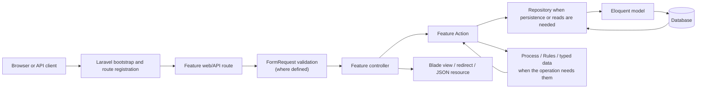

# Architecture overview

Nikaido is a Laravel 12 application organized around application features.
Feature-specific HTTP endpoints and workflows live under `app/Feature/`; shared
runtime, strategy, and process-management capabilities live under
`app/Platform/`. Laravel supplies the HTTP kernel, routing, dependency
injection, Blade rendering, Eloquent persistence, validation, and queue
infrastructure.

This page describes the implemented application structure. Backtest mechanics
and market-data rules are covered in more depth by the
[backtest-engine](../features/backtest-engine.md),
[concurrency](../features/concurrency.md), and
[data-ingestion-and-validation](../features/data-ingestion-and-validation.md)
feature pages.

## Major directories

| Location | Observed responsibility |
|---|---|
| [`app/Feature/`](../../app/Feature/) | Feature-owned controllers, routes, actions, requests, repositories, Eloquent models, and feature-specific processing. |
| [`app/Feature/Backtest/`](../../app/Feature/Backtest/) | Backtest HTTP entry points, input/configuration types, simulation and analysis processes, execution helpers, queued pair jobs, and persisted market-type run models. |
| [`app/Feature/MarketTypes/`](../../app/Feature/MarketTypes/) | Market-type Workbench endpoints and CRUD components. |
| [`app/Feature/MarketPairs/`](../../app/Feature/MarketPairs/) | Pair definitions, persistence, relationships, and market-data selection for pair runs. |
| [`app/Feature/Timeframes/`](../../app/Feature/Timeframes/) | Timeframe Workbench endpoints and persistence. |
| [`app/Feature/MarketPrice/`](../../app/Feature/MarketPrice/) | Market-price CRUD and repository queries for candles. |
| [`app/Feature/DataImport/`](../../app/Feature/DataImport/) | Provider and push ingestion, import-session handling, and its web/API routes. |
| [`app/Feature/MarketExploration/`](../../app/Feature/MarketExploration/) | Workbench market-exploration page and candle data preparation. |
| [`app/Feature/Dashboard/`](../../app/Feature/Dashboard/) | Workbench landing page. |
| [`app/Platform/Strategy/`](../../app/Platform/Strategy/) | Strategy facade, example decision-generation action, signal enum, and decision/execution-context models. |
| [`app/Platform/Infrastructure/`](../../app/Platform/Infrastructure/) | Laravel service-provider bindings; the external market-data provider contract is bound to Alpha Vantage here. |
| [`app/Platform/Console/`](../../app/Platform/Console/) | `nikaido:start` and `nikaido:stop` commands and their development-process manager. |
| [`routes/`](../../routes/) and [`bootstrap/`](../../bootstrap/) | Web/console route entry points, API route registration, framework health route, middleware/exception configuration, and application providers. |
| [`database/migrations/`](../../database/migrations/) | Schema history for market data, import sessions, queue tables, and persisted market-type backtest runs. |
| [`database/factories/`](../../database/factories/) and [`database/seeders/`](../../database/seeders/) | Laravel model factories and seeders. |
| [`resources/views/workbench/`](../../resources/views/workbench/) | Blade templates for the Workbench pages. |
| [`resources/js/`](../../resources/js/) and [`resources/css/`](../../resources/css/) | Frontend entry assets and styles. |
| [`tests/`](../../tests/) | PHPUnit tests grouped into `Unit` and `Feature`, plus strategy fixtures. |

The Composer autoloader maps `App\Feature\` to `app/Feature/`, `App\` to
`app/`, and `Nikaido\` to `src/`. The current runtime feature and platform
classes described here are in `app/`; there are no source files in `src/` in
the inspected tree.

## Application entry points and request lifecycle

The Laravel application is created in
[`bootstrap/app.php`](../../bootstrap/app.php). It registers
[`routes/web.php`](../../routes/web.php) as the web route file and registers
the Backtest and DataImport feature `api.php` files as API routes. The web
route file requires the individual feature `routes.php` files and redirects
`/` to `/workbench`. Laravel also exposes its configured `/up` health route.
The application provider list is in [`bootstrap/providers.php`](../../bootstrap/providers.php);
the platform `AppServiceProvider` binds `ExternalMarketDataProvider` to
`AlphaVantageDataProvider`.

For a Workbench request, Laravel matches the feature route, resolves any
FormRequest and controller dependencies, and dispatches the controller
method. Most CRUD and feature-page controllers pass validated input to
feature Actions and return a Blade view or redirect. The dashboard is a
simple exception: its controller directly returns the Workbench landing view.
The Backtest controller also maps persisted results to the results view or
API resource and stores a single-pair Workbench result in the session.



This diagram shows common paths, not a mandatory call chain for every
endpoint. The dashboard skips Actions and repositories; computation-only
Actions may not use a repository; and the Backtest controller has additional
session and presentation mapping.

## Persistence and feature relationships

Domain tables include `market_type`, `market_pair`, `timeframe_type`, and
`market_price`. The Eloquent relationships are represented in
[`MarketType`](../../app/Feature/MarketTypes/Model/MarketType.php),
[`MarketPair`](../../app/Feature/MarketPairs/Model/MarketPair.php),
[`TimeframeType`](../../app/Feature/Timeframes/Model/TimeframeType.php), and
[`MarketPrice`](../../app/Feature/MarketPrice/Model/MarketPrice.php):

```text
MarketType 1 ── * MarketPair 1 ── * MarketPrice
TimeframeType 1 ───────────────── * MarketPrice
```

The application uses Eloquent relationships and feature-level checks for
these market-data dependencies. The domain migrations do not declare foreign
keys for those relationships. The market-type run migration does declare a
cascading foreign key from pair-run rows to their parent run; inspect the
migrations before assuming database-level referential constraints.

Market-data features own the storage and selection of market types, pairs,
timeframes, and prices. Backtest Actions use the pair, timeframe, and price
repositories to construct inputs for the simulation. Market-type backtests
persist a parent run and per-pair results, while a single-pair Workbench
result is stored in the current session. The
[data-management guide](../user-guide/data-management.md) covers those user
workflows and their constraints.

## Backtesting and execution modes

The synchronous single-pair path loads pair candles, calls the configured
[`SpecificPairBacktestProcess`](../../app/Feature/Backtest/Process/SpecificPairBacktestProcess.php),
and returns decision/order results for presentation. The process uses the
shared [`Strategy`](../../app/Platform/Strategy/Strategy.php) entry point to
obtain candle decisions, then simulates execution without querying the
database itself.

The market-type path creates persisted run records and dispatches one
[`RunMarketTypeBacktestPairJob`](../../app/Feature/Backtest/Job/RunMarketTypeBacktestPairJob.php)
for each eligible pair through Laravel's queue. Each job invokes the same
configured single-pair Action, stores its result, and contributes to the
parent run's completion status. It requires a non-`sync` queue connection.
See [application flow](application-flow.md) for these paths in sequence.

