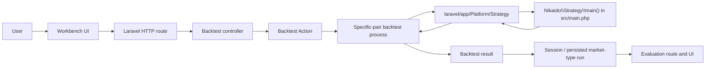

# Architecture overview

Nikaido keeps Laravel's application modules and Laravel-specific adapters in
`laravel/app/`. The strategy implementation and its domain types live in
`src/`, with `src/main.php` exposing the strategy function used by Laravel.
Framework infrastructure is encapsulated in `laravel/`; Composer and the
primary environment files remain at the repository root.

## Root layout

| Location | Responsibility |
|---|---|
| [`laravel/app/Feature/`](../../laravel/app/Feature/) | Laravel-facing features: controllers, routes, actions, requests, repositories, Eloquent models, jobs, and backtest/evaluation workflows. |
| [`laravel/app/Platform/Strategy/`](../../laravel/app/Platform/Strategy/) | Laravel adapter that forwards backtest strategy execution to `Nikaido\Strategy\main()`. |
| [`src/main.php`](../../src/main.php) | Strategy entry function, currently implementing the moving-average-cross decisions; it is not Laravel's bootstrap or a CLI strategy runner. |
| [`src/Strategy/`](../../src/Strategy/) | Strategy decision, execution-context, and signal types used across the Laravel/strategy boundary. |
| [`laravel/`](../../laravel/) | Laravel bootstrap/configuration, routes, migrations, public entry point, Blade/frontend resources, tests, and framework storage. |
| [Root `composer.json`](../../composer.json), `composer.lock`, and `phpunit.xml` | The single dependency project, autoload configuration, and test-runner configuration. `vendor/` remains at the root. |
| [Root `.env.example`](../../.env.example) | Shared environment template; Laravel loads the root `.env` regardless of the current working directory. |

The root `artisan` wrapper preserves administrative commands and delegates to
[`laravel/artisan`](../../laravel/artisan). Neither entry point runs strategies.

## Feature ownership

| Feature | Responsibility |
|---|---|
| [`Backtest`](../../laravel/app/Feature/Backtest/) | UI/API backtest entry points, execution configuration, simulation, pair jobs, and persisted market-type runs. |
| [`Evaluation`](../../laravel/app/Feature/Evaluation/) | Analysis and presentation of backtest results, including cluster, stress, and Monte Carlo evaluation. |
| [`MarketTypes`](../../laravel/app/Feature/MarketTypes/) | Market-type Workbench endpoints and persistence. |
| [`MarketPairs`](../../laravel/app/Feature/MarketPairs/) | Pair definitions, persistence, relationships, and market-data selection. |
| [`Timeframes`](../../laravel/app/Feature/Timeframes/) | Timeframe Workbench endpoints and persistence. |
| [`MarketPrice`](../../laravel/app/Feature/MarketPrice/) | Market-price CRUD, candle queries, and import persistence. |
| [`DataImport`](../../laravel/app/Feature/DataImport/) | Authenticated pushed-data ingestion and import-session handling. |
| [`MarketExploration`](../../laravel/app/Feature/MarketExploration/) | Market selection and candle data preparation for the Workbench. |
| [`Dashboard`](../../laravel/app/Feature/Dashboard/) | Workbench landing page. |
| [`Laravel infrastructure`](../../laravel/app/Platform/) | Laravel-specific strategy bridge and process commands. |

## Bootstrap and execution

Laravel HTTP and Artisan entry points load the root Composer autoloader and
[`laravel/bootstrap/app.php`](../../laravel/bootstrap/app.php). Laravel uses
the repository root as its base path for the single Composer project, while
its application code, bootstrap, configuration, database, public assets,
resources, and storage paths are located under `laravel/`. The root `.env` is
loaded regardless of the current working directory.

The UI remains the strategy execution interface:

For a single-pair run, the Backtest controller receives the UI submission and
the Action loads market data before invoking the simulation process. The
process delegates strategy decisions through the Laravel adapter to
`src/main.php`; the strategy code returns one decision per candle. The result
is retained in the browser session and displayed by the Evaluation UI.
Market-type submissions dispatch queued pair jobs; their persisted results
can be reopened through the same UI. No CLI strategy execution workflow is
introduced.

Laravel owns HTTP routing, dependency injection, validation, Blade rendering,
Eloquent persistence, database migrations, and queue infrastructure.
Repositories keep SQL selection and pagination at the database boundary;
Exact collections and Query support internal in-memory processing. Strategy
code in `src/` must not depend on Laravel models or HTTP lifecycle concerns.

## Tests and operational boundaries

PHPUnit configuration is at the root in [`phpunit.xml`](../../phpunit.xml);
test code lives in [`laravel/tests/`](../../laravel/tests/). The Composer test
script and root `php artisan test` wrapper run the existing suites. Migrations,
seeders, runtime storage, and the public entry point are under `laravel/`.

Run Laravel administrative commands from the repository root, for example
`php artisan migrate` or `php artisan route:list`. Use the Workbench to select
and execute strategies. See the [commands reference](../reference/commands.md),
[strategy guide](../user-guide/strategies.md), and
[running backtests guide](../user-guide/running-backtests.md) for user-facing
workflows.
