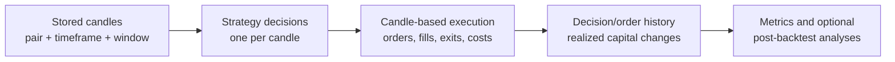

# Backtesting fundamentals

Nikaido's backtest is a historical simulation: it applies the strategy
currently wired into the application to stored market candles, then simulates
orders and position changes using configured execution rules. It is not a
connection to a broker and does not replay exchange-level messages or observe
live liquidity.

The engine is event-driven at the simulation level: it advances chronologically
through candles and applies relevant order, fill, exit, and capital changes as
they occur in that simulated timeline. This does not mean the application uses
a general event bus. In shared-capital multi-pair runs, each pair is simulated
independently first, then its recorded events are replayed together by
timestamp; this is not one live-interleaved strategy. See
[the engine lifecycle](../features/backtest-engine.md#execution-lifecycle) and
[shared-capital simulation](../features/shared-capital.md).

This page explains the model behind a run. For setup and operating steps, see
[Running backtests](../user-guide/running-backtests.md). For exact processing
rules, see the [backtest engine feature page](../features/backtest-engine.md)
and [application flow](../architecture/application-flow.md).

## From candles to results

For a selected pair, timeframe, and time window, Nikaido loads the matching
stored candles in timestamp and row-ID order. It can also load up to 200
earlier candles to warm up the current moving-average strategy. It does not
resample a timeframe, synthesize missing bars, or convert timestamp zones.
Data selection details are in [Market data](../user-guide/market-data.md).

The injected Strategy produces one decision for each loaded candle. In the
current application it delegates to a moving-average crossover with a
200-period trend filter. A decision can request `Long`, `Short`, `None`, or
`Close`; a long/short signal includes a requested quantity, stop, and target,
and can optionally specify a limit entry. The strategy does not submit a real
order. The Backtest process interprets the decision using its candle-based
entry, exit, fill, cost, and capital rules.

The process records decisions, one position-level order record per entry,
entry/exit fills, costs, and realized capital movements. Multiple partial
fills can belong to that one order record. The result analysis then derives
closed-trade summaries and optional post-run analyses. An open position at
the end of the data window is not automatically liquidated and has no
completed trade P&L.

## Historical simulation is not live trading

A run is conditional on a fixed dataset, strategy implementation, initial
capital, schedule, and execution configuration. If these inputs and ordering
are unchanged, a single-pair simulation is deterministic. That does not make
the simulated fills equivalent to live fills:

- Candle OHLC does not reveal the sequence of prices inside a bar. If a stop
  and target are both reached in one candle, Nikaido chooses the stop first.
- A stop or target that is reached is filled at its configured level, then
  configured slippage is applied; a gap-through fill is not reconstructed
  from tick data.
- Market decisions can be generated using the candle close while the market
  entry is priced from that same candle's open. This timing can use
  information that would not have been available at the open.
- Quote prices fall back to general OHLC when unavailable. No spread is
  invented when only general OHLC is present.
- Synthetic partial fills use a configured quantity ratio, not candle volume
  or order-book liquidity.

These are material simulation assumptions, not implementation details to
ignore when interpreting a result. Order-level rules are described in
[Order and execution semantics](order-and-execution-semantics.md).

## Strategy, execution, and research boundary

Strategy decisions and execution assumptions are separate. The wired strategy
defines signal, stop/target, and requested size; the process defines how those
instructions are tested against historical prices. Fixed slippage, partial
fills, bid/ask selection, and configurable transaction or holding costs
affect simulated execution but do not alter the supplied candle history.
Strategy parameters and the current strategy choice are not selectable in the
Workbench; see the [strategy guide](../user-guide/strategies.md).

Market-type runs execute independent pair histories first. Shared-capital
allocation later replays their recorded events in timestamp order. It is not
one strategy observing synchronized markets while making decisions. See
[Capital and risk](capital-and-risk.md) and
[multi-pair backtesting](../features/multi-pair-backtesting.md).

The resulting statistics describe the selected historical sample under the
implemented model. They do not establish that a strategy has a durable edge,
prove that data is complete or representative, or forecast future returns.
Review data provenance, warm-up, quote coverage, costs, exposure, and
limitations before drawing conclusions.
