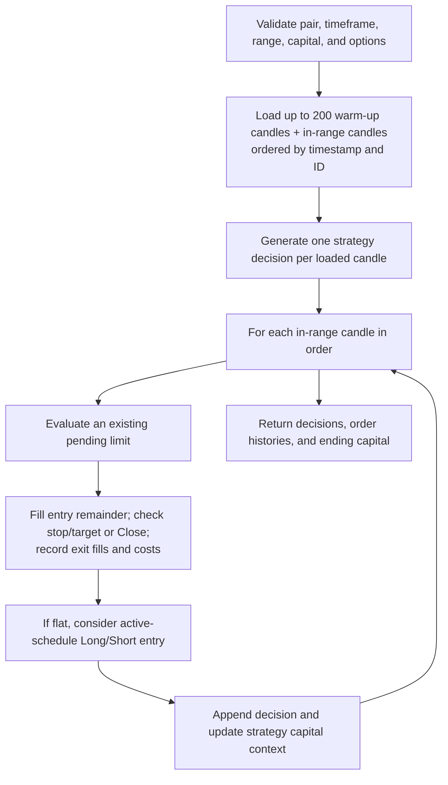

# Backtest engine

## Purpose and scope

The backtest engine turns the strategy wired into Nikaido into a chronological,
candle-based, event-driven simulation. For a single pair it loads history,
obtains one strategy decision per candle, processes applicable orders, fills,
exits, and resulting capital changes, then returns decision and order histories
plus ending capital. It is a deterministic historical calculation for a fixed
input and configuration; it is not a broker simulator or a live-equity
accounting system.

“Event-driven” here describes applying simulation state changes as the ordered
candle, order, and fill events are processed. It does not describe a general
application event bus or event-sourcing architecture. In shared-capital
market-type runs, each pair is simulated independently before recorded events
are replayed in timestamp order; see
[shared-capital simulation](shared-capital.md).

The main flow is implemented by
[`RunSpecificPairBacktestAction`](../../app/Feature/Backtest/Action/RunSpecificPairBacktestAction.php),
[`SpecificPairBacktestProcess`](../../app/Feature/Backtest/Process/SpecificPairBacktestProcess.php),
and
[`GenerateMovingAverageCrossDecisionsAction`](../../app/Platform/Strategy/Actions/GenerateMovingAverageCrossDecisionsAction.php).
The Workbench currently uses the fixed example strategy; it has no strategy
selector or per-run strategy-parameter editor. See the
[strategy guide](../user-guide/strategies.md) for its decision contract.

## Inputs and validation

The configured workflow selects a market pair, timeframe, date/time range,
initial capital, active schedule, excluded ISO weekdays, and optional
slippage, partial-fill, and trade-cost settings. HTTP validation requires
existing pair/timeframe records, positive capital, `from <= to`, and dates in
`Y-m-d H:i:s` form. Full-day mode is represented by both active-time boundaries
being false; otherwise each is `HH:MM`. Weekdays are ISO numbers 1 (Monday)
through 7 (Sunday).

The pair repository loads at most 200 candles before `from` for indicator
warm-up, then candles in the inclusive requested interval. Both groups are
restricted to the selected timeframe and sorted by `price_date`, then row ID.
Warm-up decisions are consumed to keep the strategy's indicator history
aligned, but candles earlier than `from` are not simulated. No candle
resampling, gap creation, or timezone conversion occurs.

`SpecificPairTestConfig` independently checks non-empty base/quote, ordered
dates, positive finite capital, positive optional IDs, and valid weekday
numbers. Configuration objects also validate slippage, fill ratios, and fee
components. Invalid execution data is surfaced as a validation or domain error;
missing candles and no candles in the active schedule are rejected rather than
returned as a successful zero-trade simulation.

## Execution lifecycle

The strategy sees the full loaded close series, including the current candle.
The example strategy computes its indicators from closes and can produce an
entry decision for that same candle, while a market entry uses that candle's
open. This timing is a look-ahead risk, not a guarantee of an executable
open-price signal.

Within each candle, the process first works on an existing pending or open
order, then considers a new entry if there was no active order at the start of
the candle. A new market order is opened at the signal candle's open and is
not checked against that candle's stop/target range in the same pass. A limit
instruction remains pending until a later candle qualifies. Existing stop and
target monitoring continues outside the active entry schedule; the schedule
gates strategy decisions, not risk management.

Only one active order/position or pending entry can exist in the single-pair
process. The engine evaluates stop-loss before take-profit when both candle
extremes reach their levels. A strategy `Close` signal is handled only while
the candle is in the active schedule, and only after a price exit has not
already taken precedence. A `Close` uses the candle's open quote. See
[order types](order-types.md) and [limit orders](limit-orders.md) for fill
semantics.

## Capital, fills, and result state

For each entry fill, the engine records quantity, price, timestamp, and source,
and deducts entry transaction costs from current capital. For each exit fill,
it calculates gross price P&L, subtracts exit/holding costs, records net
realized P&L, and adds that amount to capital. There is no notional reservation
or margin check in the single-pair engine. Open positions are not marked to
market, and the engine does not force liquidation at the end of the selected
window; an unfinished position has no completed-trade P&L.

Position quantity, instrument multiplier, and risk are distinct fields.
`units` use a multiplier of one; `contract` uses configured contract size as a
P&L multiplier; `lot` converts lots to position units using contract size.
Risk and quantity calculation details are in
[capital and position sizing](../user-guide/capital-and-position-sizing.md)
and [shared capital](shared-capital.md).

## Determinism, errors, and limitations

With unchanged candle rows, strategy code, config, and ordering, the single
pair execution path has no random component. The order-by-timestamp/ID query
provides a stable order even for duplicate timestamps, but duplicates remain
bad input. Monte Carlo uses randomness separately; it does not affect the
backtest.

The engine rejects a strategy result that ends before the candles do, an entry
without positive quantity or stop/target, equal entry and stop prices, an
unusable entry price, and an exit without a usable reference price. It raises
on non-numeric closes in the included moving-average strategy. Missing candles
are not interpolated. OHLC data cannot establish intrabar event order, so the
engine's stop-first tie rule is an explicit adverse assumption. Stop and target
fills use their level rather than reconstructing gap-through execution.

The included strategy is evaluated over the full series before candle-by-candle
execution. Some analyses use only closed trades or recorded exit events; they
do not add unrealized P&L or recreate a complete intrabar equity curve.

## Verification and related documentation

Focused coverage is in
[`SpecificPairBacktestDomainTest`](../../tests/Unit/Engine/Domain/SpecificPairBacktestDomainTest.php)
and
[`RunSpecificPairBacktestActionFeatureTest`](../../tests/Feature/RunSpecificPairBacktestActionFeatureTest.php).
Run the relevant tests with the commands in
[Running tests](../getting-started/running-tests.md).

Related: [Running backtests](../user-guide/running-backtests.md),
[market data](../user-guide/market-data.md),
[orders and positions](../user-guide/orders-and-positions.md),
[transaction costs](transaction-costs.md), and
[performance metrics](performance-metrics.md).
